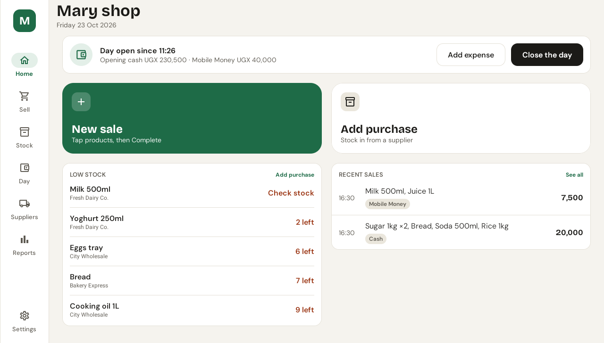
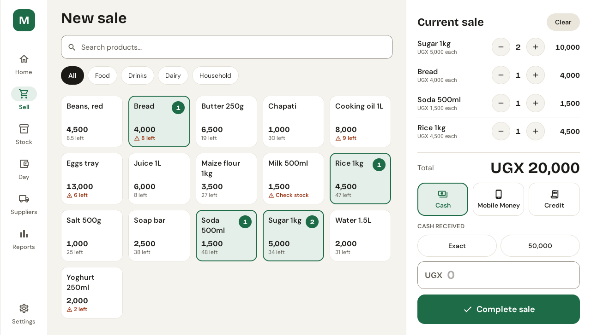
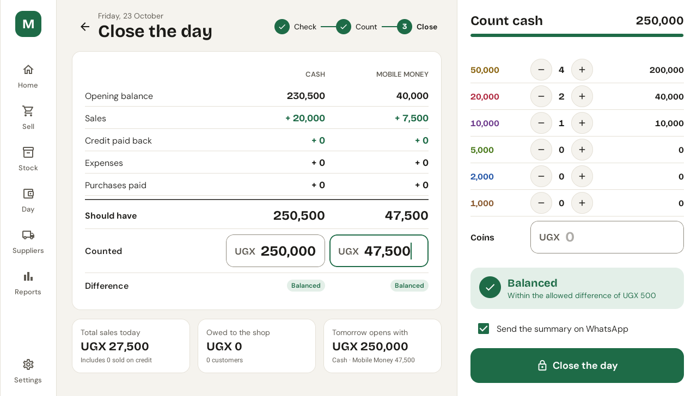
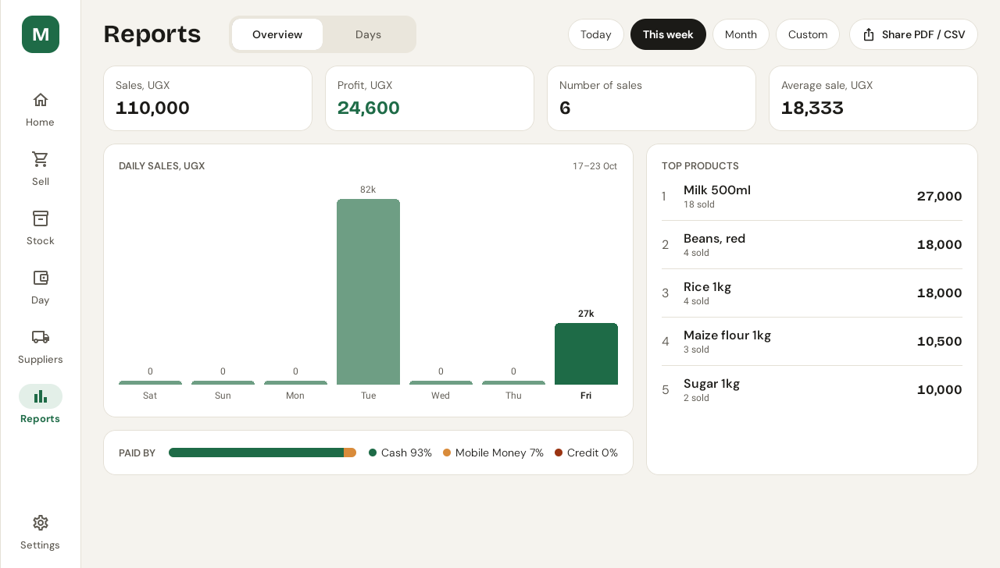
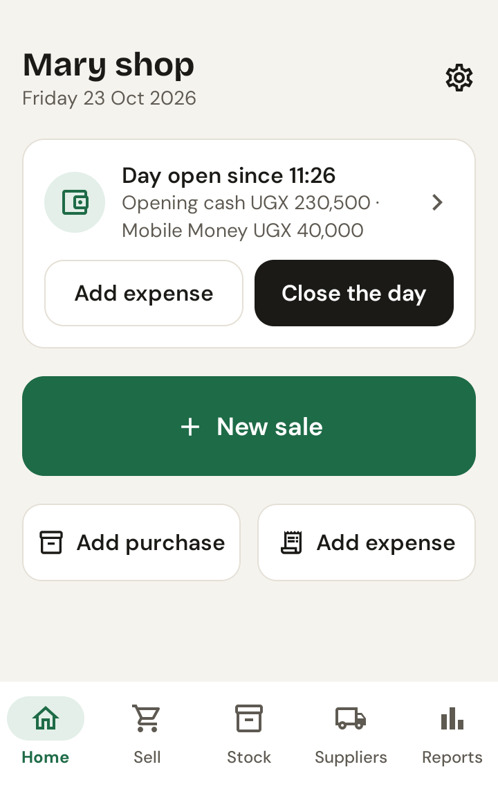

# Arch-SME

An offline shop manager for small shops. Sell, keep stock, order from suppliers and balance the day's cash, on an Android tablet at the counter or on a phone.

Built for a small retail shop in Kampala: amounts are in Ugandan shillings, Mobile Money sits next to cash, and nothing needs the internet.



## What it does

- **Sell in two taps on a tablet, three on a phone.** Tap products, then Complete. Cash, Mobile Money, or credit to a named customer, with quick cash amounts, change, and a 6-second Undo.
- **Stock that adds up.** Purchases (paid now or not paid yet), new products with starting stock, and stock corrections. Every change is a recorded movement, so stock always equals the sum of its history. Low stock is flagged on Home, in Sell and in Stock.
- **Suppliers and reorders.** Each supplier's products, a suggested reorder quantity, and an order message ready to send on WhatsApp.
- **The day's money.** Open the day with a note counter, record expenses, credit paid back and cash in or out, and see who owes the shop. Close the day in three steps: check what the drawer should hold, count it note by note, and close with a reason if it is short or over. You can send a summary on WhatsApp, and a reminder shows if you forget to close.
- **Reports.** Sales, profit, a daily chart, how customers paid, and top products, by day, week, month or a custom range. Export to PDF or CSV.
- **Safe by default.** Nothing is deleted: a sale is voided with a reason, and a closed day is read-only. An optional PIN guards voids, stock corrections, closing, reopening and restoring. Backups are a single zip, with an automatic backup (the last 7 kept) after each closed day.

| Sell | Close the day | Reports |
| --- | --- | --- |
|  |  |  |



### Tablet first, phone too

The same screens adapt to the space they have:

- **Tablet in landscape:** a navigation rail and two panes, for example the product grid beside the cart.
- **Tablet in portrait:** the rail stays.
- **Phone:** a bottom bar, with Checkout on its own screen.

Light and dark themes. Layouts hold at 200% font size.

### Languages

English, Kiswahili and Portuguese are complete. Luganda and Tigrinya are drafts in progress. Strings without a translation show in English. Amounts always use Latin digits with commas (UGX 25,000), whatever the language.

<br clear="right">

## Building

Requirements:
- JDK 17.
- The Android SDK with platform 36.
- A device or emulator on Android 8.0 (API 26) or newer.

```sh
./gradlew assembleDebug          # debug APK in app/build/outputs/apk/debug/
./gradlew installDebug           # install on the connected device
```

Debug builds fill an empty install with a demo shop ("Mary shop") so every screen has data. Release builds start empty and walk you through onboarding.

### Tests

```sh
./gradlew testDebugUnitTest            # JVM tests: domain logic and Room DAOs on an in-memory database
./gradlew connectedDebugAndroidTest    # Compose UI tests on a device; uninstalls the app afterwards
```

The JVM suite covers:
- The balance arithmetic for closing a day.
- Voids and credit.
- A sale that fails halfway leaving nothing behind.
- Stock always matching its movements.

The UI tests check that a phone sale takes 3 taps and a tablet sale 2.

### Release build

```sh
./gradlew assembleRelease
```

To sign it, point the `arch.signing` Gradle property at a properties file that holds `storeFile`, `storePassword`, `keyAlias` and `keyPassword`. Set the property in your own `~/.gradle/gradle.properties`, never in the repo. Without it the APK in `app/build/outputs/apk/release/` is built unsigned.

## How it is built

Kotlin, Jetpack Compose with Material 3, Hilt, Room (with KSP), DataStore, and WorkManager. There is one `app` module, layered by package under `com.archsolutions.shopmanager`:

| Package | Holds |
| --- | --- |
| `core/` | Money (UGX as `Long`, never floating point), the design system (theme and shared components), language switching, clock. |
| `data/` | One Room database, its DAOs and the repositories features use. Any write that touches more than one table runs in a single transaction. Settings in DataStore; backup and restore. |
| `domain/` | Business rules shared by screens: the note counter, cart totals and rounding, the day's balance, debtors, reorder quantities and message texts. |
| `feature/` | One screen (and ViewModel) per area: home, sell, sales, stock, suppliers, day, reports, settings, PIN, onboarding. |
| `app/` | The application, navigation and the day gate. |

Rules the code keeps:
- **Selling stays locked until the day is open.** The UI greys out actions, and every sale, purchase and money entry is also checked at the data layer. A day is never opened implicitly.
- **Restores are never applied under a live database.** A restore is checked, staged, and applied on the next start.
- **All user-facing text lives in `strings.xml`.** That keeps every screen translatable.

### Translating

`tools/translation_sheet.py` turns the strings into a spreadsheet a translator can fill in. Each row shows the English, where it appears in the app, and the marks to keep. The same tool reads the sheet back:

```sh
uv run --with openpyxl tools/translation_sheet.py export ti translations/Arch-SME_Tigrinya.xlsx
uv run --with openpyxl tools/translation_sheet.py import ti translations/Arch-SME_Tigrinya.xlsx
```

The import refuses a sheet where a placeholder such as `%1$s` went missing.

## Install

Download `arch-sme-1.0.0.apk` from the [latest release](https://github.com/nhmdnl/shop-manager/releases/latest). Open it on the tablet or phone, and allow installing from that source when Android asks. It needs Android 8.0 or newer.

The first start walks through setting up the shop and opening the first day. Updates install over the top and keep the shop's data.

## Status

Version 1.0.0 is the first release. See [CHANGELOG.md](CHANGELOG.md). Still to do:
- Check performance on a low-end tablet.
- Finish the Luganda and Tigrinya translations.

## Licenses

The app's code is under the [MIT License](LICENSE).

The bundled fonts are under the SIL Open Font License 1.1; their license texts are in [`licenses/`](licenses):
- [Bricolage Grotesque](https://github.com/ateliertriay/bricolage) for display text and amounts.
- [DM Sans](https://github.com/googlefonts/dm-fonts) for body text.
- [Noto Sans Ethiopic](https://github.com/notofonts/ethiopic) for Tigrinya.
